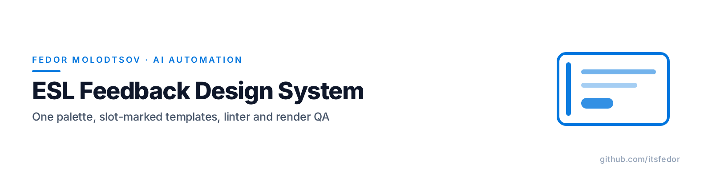
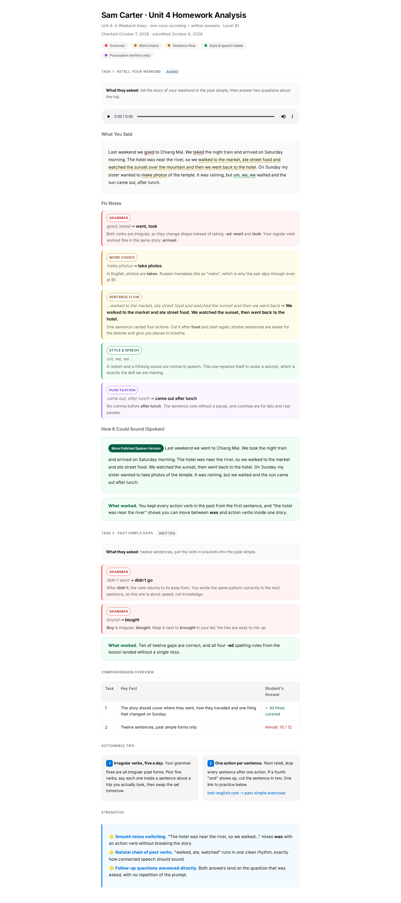
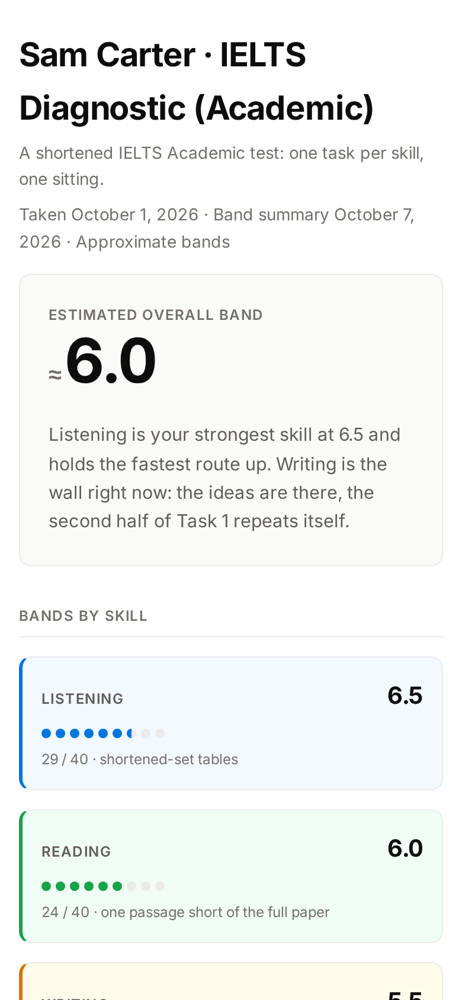

<picture>
  <source media="(prefers-color-scheme: dark)" srcset="assets/banner-dark.png">
  
</picture>

<p align="center"><sub><b>Fedor Molodtsov</b> — AI automation engineer · <a href="https://github.com/itsfedor">github.com/itsfedor</a></sub></p>

# ESL Feedback Design System

[](LICENSE)
[](docs/design-system.md#contrast-wcag-2x)
[](tools/qa_run.py)

A small, strict design system for ESL student-feedback documents: homework
analyses and IELTS band cards. One palette, slot-marked HTML templates, a
static conformance linter and a render-QA runner. Built for a real teaching
practice where the student reads feedback on a phone and every document must
behave the same way.

It is a working style turned into a system: 26 drifting font sizes folded into
6, a pile of one-off hex values collapsed into 5 semantic roles, and every
decision pinned by numbers. WCAG contrast minimums with measured values,
colour-blindness simulation, a mobile-first layout at 390px, a print
stylesheet, and two tools that must both be green before a document ships.

## Ship a document in four steps

1. Copy `templates/homework-analysis-template.html` (or the band-card
   variant) and fill every `<!-- SLOT -->` marker. Only classes from the
   system; no new colours, sizes or spacings.
2. `python3 tools/check_design.py doc.html` — static conformance, 9/9 expected.
3. `python3 tools/qa_run.py doc.html` — headless Chromium: console errors,
   overflow, fonts, audio, screenshots.
4. Deliver. A later change means a new dated file, never an edit.

```bash
python3 -m pip install playwright
python3 -m playwright install chromium
```

## Screenshots





## Demo documents

[`examples/demo-homework-analysis.html`](examples/demo-homework-analysis.html)
and [`examples/demo-band-card.html`](examples/demo-band-card.html) are
synthetic documents (no real student content). Both pass: linter **9/9** ·
Playwright QA **PASS** at 1440×900 and 390×844 — 0 console errors, 0 px
overflow, Inter loaded, audio present. The machine reports ship in
`assets/qa-report-*.json`.

## What's inside

```
esl-feedback-design-system/
├── templates/   homework-analysis-template.html · band-card-template.html · REPLACE-ME.wav
├── tools/       check_design.py · qa_run.py · selftest.sh · fixtures/
├── examples/    demo-homework-analysis.html · demo-band-card.html · demo-tone.wav
├── docs/        design-system.md (full spec, v1.5)
├── assets/      banners · demo screenshots · QA reports
└── tokens.json  machine-readable palette, type scale, spacing (read by the linter)
```

## The system in one minute

- **Five semantic colour roles** (grammar / word choice / sentence flow /
  style & speech / punctuation), each a base + tint + ink triplet, all
  contrast-checked against the nine backgrounds they sit on.
- **Redundant encoding:** colour never carries meaning alone. Every fix card
  repeats its category as a text chip, and the legend order is fixed — so the
  document still reads under deuteranopia.
- **Six font sizes, one 4px spacing grid, three radii, no shadows.** The
  linter fails any value outside the scale.
- **Mobile-first, print-friendly, accessible:** 390px layout, scrolling table
  wrappers, `:focus-visible` outlines, a print stylesheet, zero inline styles,
  zero third-party JavaScript.
- **A band-card variant** for IELTS diagnostics: dot-scale bands per skill and
  pastel skill-coded blocks (v1.4), same tokens.

Full spec: [docs/design-system.md](docs/design-system.md). Machine-readable
tokens: [tokens.json](tokens.json).

## Tools

| Tool | What it checks |
|---|---|
| `tools/check_design.py` | Structure, version stamp, required components, inline styles, print/focus rules, font scale, palette. Python stdlib only |
| `tools/qa_run.py` | Headless Chromium at desktop + mobile: console and page errors, horizontal overflow (locates the culprit by bisection), fonts, audio sources, screenshots, `qa-report.json` |
| `tools/selftest.sh` | Runs both tools against the known-good / known-bad fixtures and asserts exit codes |

`qa_run.py` expects at least one `<audio>` with a source; for written-only
documents pass `--allow-no-audio`.

## License

MIT © Fedor Molodtsov
